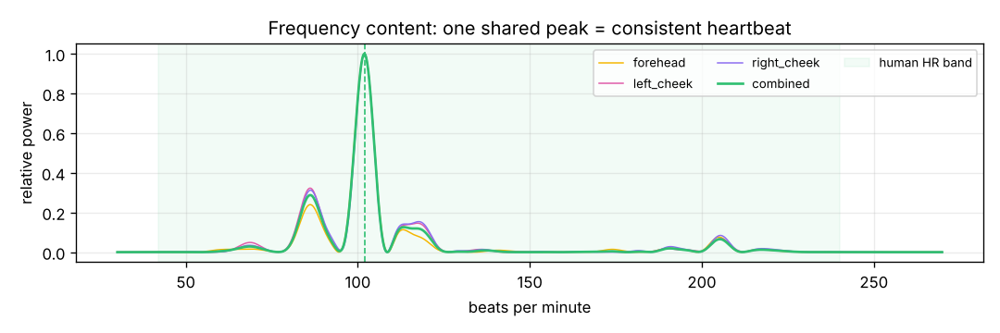
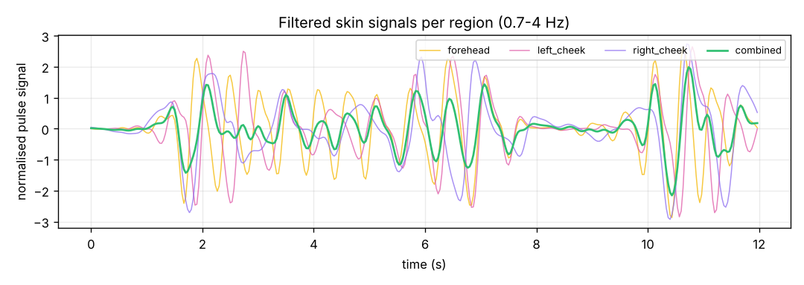
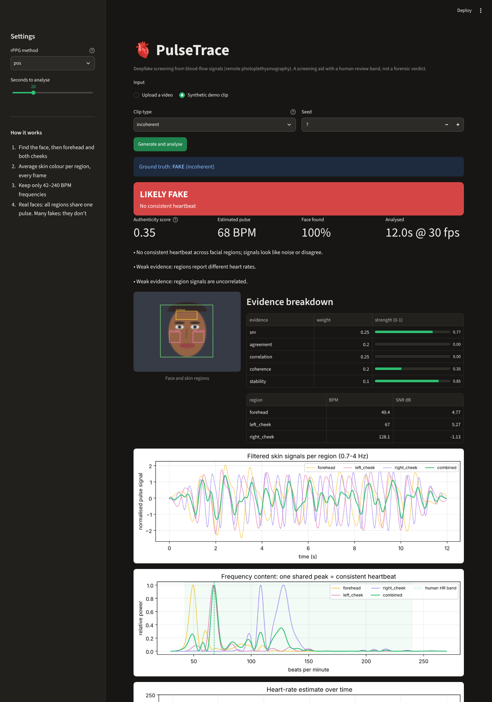

# PulseTrace

Deepfake screening from facial blood flow. Each heartbeat pushes blood into the skin and changes its colour very slightly. A camera picks this up even though the eye cannot (remote photoplethysmography, rPPG). PulseTrace measures that signal on the forehead and both cheeks and checks whether all three regions share one heartbeat. Real faces usually do. Many generated or face-swapped videos do not.

It is a screening aid. It gives a 0–1 score, a verdict, plain-language reasons, and a human-review band for clips it cannot judge confidently.

| Real clip: one shared peak | Fake clip: regions disagree |
|---|---|
|  |  |



## What it does

- Finds the face and tracks it, then places forehead, left-cheek and right-cheek regions, keeping only skin pixels
- Turns each region into a pulse signal with one of three methods: green channel, POS (default) or CHROM
- Band-passes to 42–240 BPM and estimates heart rate and signal quality (SNR) per region
- Scores five kinds of evidence: pulse strength, BPM agreement between regions, correlation, coherence at the heart-rate frequency, and BPM stability over time
- Returns `LIKELY_REAL` (score ≥ 0.60), `LIKELY_FAKE` (≤ 0.40), `NEEDS_REVIEW` (between), or `INCONCLUSIVE` when the clip is too short, below 10 fps, or has no stable frontal face
- Comes with a web UI (upload or synthetic demo, plots, JSON export, reviewer labelling), a CLI, a webcam mode, and an evaluation harness that writes metrics and a human-review queue

## How it relates to Intel FakeCatcher

The idea comes from FakeCatcher (Ciftci, Demir & Yin, *IEEE TPAMI* 2020): genuine faces carry spatially and temporally consistent PPG signals and synthetic ones mostly do not. FakeCatcher trains a classifier on PPG maps and also uses eye movement. PulseTrace uses a small set of hand-weighted features you can read and audit, because no licensed deepfake dataset was available to train on. See [docs/FEATURE_MATRIX.md](docs/FEATURE_MATRIX.md) for a feature-by-feature comparison with the source video.

## Install

Python 3.10 or newer.

```bash
git clone https://github.com/DatshinAbinanthRaj/pulsetrace-rppg-deepfake-screening.git
cd pulsetrace-rppg-deepfake-screening
python -m venv .venv && source .venv/bin/activate      # Windows: .venv\Scripts\activate
pip install -e ".[app,dev]"
```

No API keys or paid services. Everything runs offline on a CPU. `.env.example` lists the one optional setting (where reviewer labels are saved).

## Use

**Web UI**

```bash
streamlit run app/streamlit_app.py
```

Upload a video with one frontal face, or pick "Synthetic demo clip" to see a real and a fake case without needing your own footage.

**CLI**

```bash
pulsetrace analyze my_clip.mp4                     # summary
pulsetrace analyze my_clip.mp4 --json --plots out/ # JSON + signal, spectrum and ROI images
pulsetrace analyze my_clip.mp4 --method green      # the method shown in the video

pulsetrace synth --out data/bench --per-kind 5     # labelled synthetic benchmark
pulsetrace evaluate data/bench/manifest.csv --out results/eval
pulsetrace stress --out results/stress             # pulse strength x noise sweep
pulsetrace live                                    # webcam (local machine, needs opencv-python with GUI)
```

Example output:

```
Verdict : LIKELY_FAKE
Score   : 0.24
Pulse   : 98 BPM
Clip    : 12.0s @ 30.0 fps, face found 100%
  forehead     bpm= 102.0  snr= -3.27 dB
  left_cheek   bpm=  82.6  snr= -0.93 dB
  right_cheek  bpm=  49.4  snr=  0.07 dB
  - No consistent heartbeat across facial regions; signals look like noise or disagree.
  - Weak evidence: regions report different heart rates.
  - Weak evidence: region signals are uncorrelated.
```

**Python**

```python
from pulsetrace import analyze_video, AnalysisConfig
rep = analyze_video("clip.mp4", AnalysisConfig(method="pos"))
print(rep.verdict, rep.score, rep.bpm, rep.reasons)
```

## Tips for usable input

At least 6 seconds (10–30 is better), 25–30 fps, the face filling a good part of the frame, steady lighting, little compression. Heavily compressed or low-resolution video weakens the blood-flow signal, and the tool will often abstain on it.

## Results

All numbers come from synthetic clips with procedurally drawn faces and known ground truth:

| Run | Clips | Accuracy | Real flagged as fake | ROC-AUC | BPM error |
|---|---|---|---|---|---|
| Benchmark (encoded video files) | 30 | 1.00 | 0.00 | 1.00 | 0.27 BPM |
| Pulse strength × noise sweep | 96 | 1.00 in all 8 cells | 0.00 | 1.00 | ≤ 0.33 BPM |

These numbers show the pipeline works as designed. **They do not show accuracy on real deepfakes.** The synthetic faces have flat skin with no texture, so motion and lighting are far easier than in real footage. [docs/EVALUATION.md](docs/EVALUATION.md) explains the gaps and how to run the harness on a licensed dataset such as FaceForensics++ or Celeb-DF.

## Testing

```bash
pytest -q            # 42 tests: DSP, face/ROI, analysis, evaluation, CLI, web UI flow
ruff check .
bandit -r pulsetrace app -s B101
```

Last run: 42 passed, lint clean, no bandit findings, no known dependency vulnerabilities. Details, plus the bugs found and fixed during testing, are in [docs/TEST_RESULTS.md](docs/TEST_RESULTS.md). CI runs the same checks on Python 3.10 and 3.12.

## Project layout

```
pulsetrace/      library: video, face, dsp, analysis, synthetic, evaluate, viz, cli, live
app/             Streamlit web UI
tests/           pytest suite
examples/        extra experiments (head-motion stress check)
docs/            architecture, feature matrix, evaluation, test results, screenshots
```

Architecture and design decisions: [docs/ARCHITECTURE.md](docs/ARCHITECTURE.md).

## Known limitations

- Validated only on synthetic data. Thresholds were set by hand.
- A generator that keeps a coherent skin-colour pulse (for example reenactment that transfers it from a source video) will pass as real.
- Haar face detection needs a roughly frontal face. Profiles, masks and heavy occlusion end up as INCONCLUSIVE.
- Real clips can be flagged as fake when the pulse is buried by compression, makeup, low light or movement. Public testing of FakeCatcher found the same problem, which is why the review band exists.
- Audio is not analysed.
- Webcam mode was written but not run (no camera in the build environment).

## Possible next steps

- Evaluate on FaceForensics++ / Celeb-DF and calibrate thresholds on a held-out split
- Learned classifier on PPG maps, as in FakeCatcher, alongside the readable features
- MediaPipe face mesh for tighter, motion-robust skin regions
- Per-segment verdicts to localise partial manipulations
- Reviewer agreement statistics from the review log

## Ethics

A deepfake score can damage a real person if treated as proof. Use the output to prioritise human review, not to accuse anyone, and keep `real_flagged_as_fake_rate` in view when you evaluate it.

## License

MIT. See [LICENSE](LICENSE).
